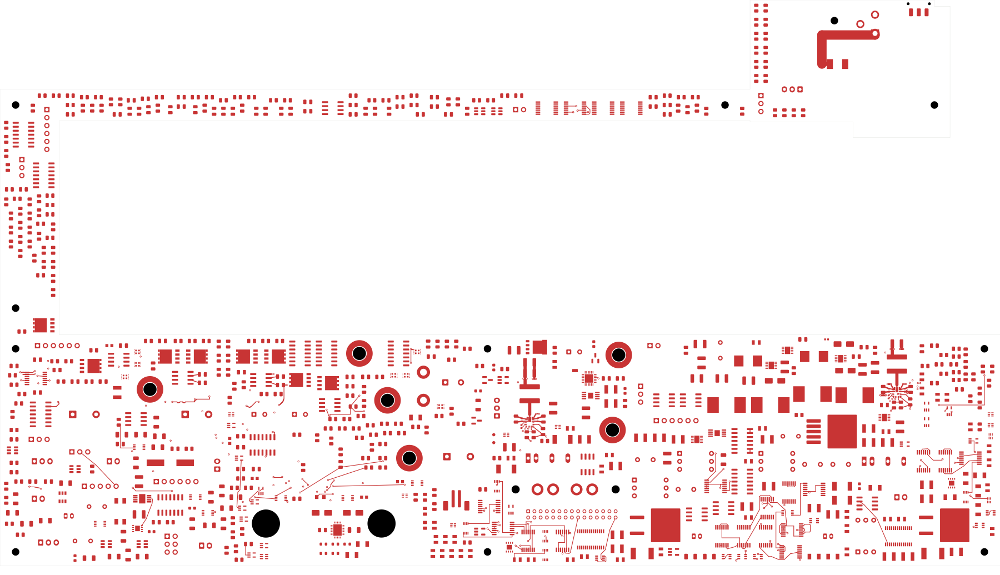
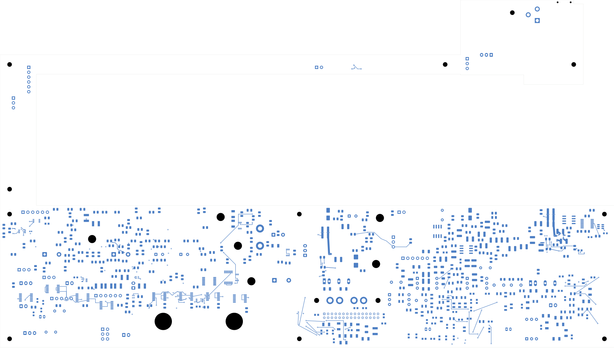

# Power/protection — U20 sense and configuration

U20's dedicated output sense, feedback trim, FSEL and MODE networks are now
connected. The power board has **2,472 open connections**, six fewer than the
preceding revision, and remains **not ready for fabrication**.
Open [power_protection.kicad_pro](power_protection.kicad_pro) in KiCad.

## Local changes

Thirteen route sections add 16 tracks and seven conventional 0.60/0.30 mm vias.
No component moves, value/package changes, or alterations to earlier copper.

| Connection | Saved routing |
| --- | --- |
| Output sense | C207.1 → back tap → In2 → back R200.1 |
| Feedback trim | R200.2 → dedicated via → R206.1 |
| FSEL | U20.1 → via at (176,138.55) → R202.1 |
| MODE | U20.2 → via at (177,138.55) → R203.1 |
| Configuration returns | R202.2 and R203.2 join the BP5/AGND group through local back/In1 routes |

The 0.2 mm sense route runs left of the switching region: its In2 portion is
24.05 mm, with 2.366 mm and 2.152 mm back-side endpoints. The independent native
geometry check finds **1.15 mm minimum projected copper-edge separation** from
SW/BOOT/BOOT_RETURN copper on every layer. This is a dedicated sense path,
not a force-current feed. Its adjacent reference plane is still unfinished.

The trim via at (177.8,142.5) connects the existing 9 kΩ R200 and 54.9 Ω R206
without crossing the nearby ground pad. The FSEL back-side elbow clears the
MODE-ground via. Quiet-ground vias sit at (182.8,141.1), beside BP5's ground
connection, and (175.3,139.3). Their In1 link joins the configuration returns.
**This quiet group remains separate from the regulator PGND group in physical
copper; their intended low-impedance connection is still pending.**

## Verification

| Item | Checked result |
| --- | --- |
| Electrical components / footprints | 1,085 / 1,100 |
| Schematic pins / mapped pads | 3,418 / 3,479 |
| Tracks / through vias | 2,232 / 164 |
| Native opens / connections closed this pass | 2,472 / 6 |
| Geometry / schematic parity / ERC errors | 0 / 0 / 0 |
| Retained isolated-reference warnings | 2 |
| Earlier physical connection groups preserved | All 3,216 |
| Minimum all-via drill-to-SMD gap | 0.165 mm |
| Existing U23 authored zones and native fill | Both unchanged |

[Native checks](review.json) · [Independent audit](u20-control-audit.json)
· [Construction](u20-control-routing.json)
· [Full connectivity capture](../two-board-power-routing-inputs-2472-u20-control/capture.json)
· [Previously rejected source-net review](rejected-source-net-status.json)

Every retained component, pin/net assignment, copper object and earlier physical
group is checked. New tracks/vias belong to the intended sense, trim, FSEL,
MODE or quiet-ground groups. All new copper is more than 2 mm from existing U23
zone boundaries, with native saved fill unchanged. The capture records 6,115
ordinary objects, two zones, 552 open nets and 3,024 open-net clusters; the
uncapped native count and independent cluster-gap sum agree.

## Actual copper views

| Front | Back, in top-view coordinates |
| --- | --- |
|  |  |

[Local front](plots/local-front.png) · [Local back](plots/local-back.png)
· [Local quiet-ground link](plots/local-inner1.png) · [Local sense](plots/local-inner2.png)
· [Six inner layers](plots/inner-contact-sheet.png) · [Visual review](plots/visual-review.json)

## Remaining work

Complete U20 input topology, enable wiring and VIN/PGND/reference planes.
The [capacitor review](../two-board-input-capacitor-review-01/README.md) records
actual selections, initial/temperature budgets and the remaining bias/aging
evidence. It makes no part substitutions or full operating-capacitance claims.
The four output parts are 47 µF/25 V/X7S, not the older generic X7R description.

U23 wider feed, AUX/other critical cells, board-wide routing, loaded power and
fault behavior, ESS package inputs, final physical interfaces, exact BOM,
accepted stack/process, manufacturing outputs and full housing fit remain open.
Former internal return-bar functions still need qualified PCB paths and revised
assembly hardware. Signal main remains at 251 opens with its codec footprint
absent. No fabrication order or release has been made.
