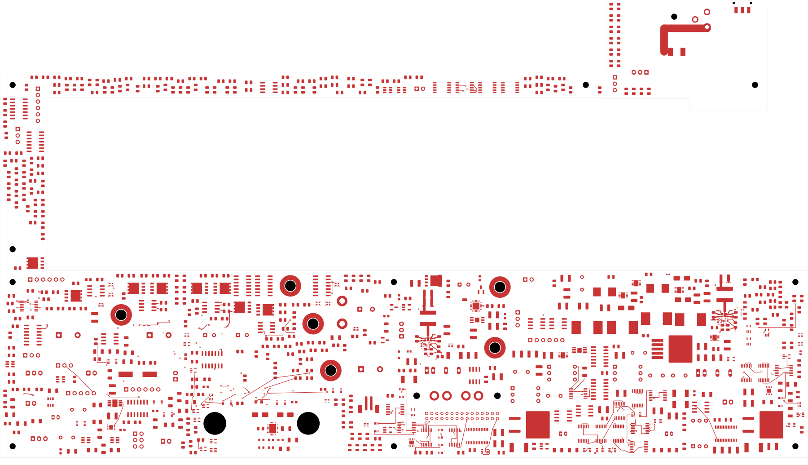
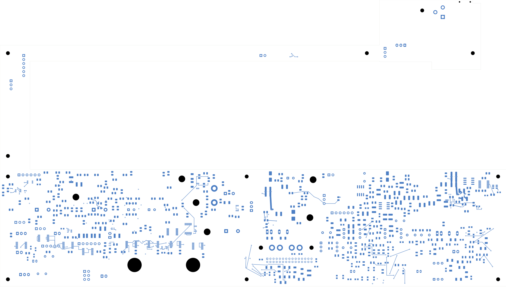

# Power/protection — U20 enable connection

U20's EN pin now connects to the existing R204 feed and R205 pull-down. The
pull-down return joins the local BP5/AGND group. There are **2,469 open
connections**, three fewer than the previous revision. **Not ready for fabrication.**
Open [power_protection.kicad_pro](power_protection.kicad_pro) in KiCad.

## Local changes

Six route sections add eight 0.20 mm tracks and three conventional 0.60/0.30 mm
through vias. Component positions, values, packages and all previous copper are
unchanged. R204's already connected POWER_READY terminal stays in place.

| Connection | Saved route |
| --- | --- |
| U20.7 EN escape | Front dogleg, 0.997 mm, to via (177.8,137.025) |
| Local EN branch | In4, 7.318 mm, to via (180.8,143.7) |
| R205.1 pull-down | Front, 1.336 mm, from the local via |
| R204.2 feed | Back, 1.200 mm, to via (223.2,126.1) |
| Feed to local branch | In4, 49.690 mm, around the intervening mounting reserve |
| R205.2 return | Front, 1.460 mm, to the existing quiet-ground via (182.8,141.1) |

The inner-layer branch avoids crossing the existing back-side configuration
return. This establishes connectivity, but does not qualify noise immunity,
startup timing or the full enable voltage/current bounds. The long feed and
its reference/return environment require review with the final plane design.
The [shared-enable DC scenario screen](../two-board-power-buck-enable-native-01/enable-dc-screen.json)
remains an allocated engineering screen, not a guarantee across all conditions.

The BP5/AGND quiet group is still physically separate from the U20 PGND group.
The final low-impedance connection, input network and sense/reference planes
remain unfinished. The previous output-sense, trim and configuration wiring is
preserved; [that revision](../two-board-power-u20-control-native-01/README.md)
records its geometry and design limits.

## Verification

| Item | Checked result |
| --- | --- |
| Electrical components / footprints | 1,085 / 1,100 |
| Schematic pins / mapped pads | 3,418 / 3,479 |
| Tracks / through vias | 2,240 / 167 |
| Native opens / connections closed this pass | 2,469 / 3 |
| Geometry / schematic parity / ERC errors | 0 / 0 / 0 |
| Retained isolated-reference warnings | 2 |
| Earlier physical connection groups preserved | All 3,210 |
| Minimum all-via drill-to-SMD gap | 0.165 mm |
| Existing U23 authored zones and native fill | Both unchanged |

[Native checks](review.json) · [Independent audit](u20-enable-audit.json)
· [Construction](u20-enable-routing.json)
· [Full connectivity capture](../two-board-power-routing-inputs-2469-u20-enable/capture.json)
· [Previously rejected source-net review](rejected-source-net-status.json)

The audit checks every retained physical copper object, component geometry and
pin/net assignment. All new objects belong to the intended EN or quiet-ground
group; the R204 divider is not bypassed. Every new copper object is more than
2 mm from existing U23 zone boundaries. The capture records 6,126 ordinary
objects, two zones, 551 open nets and 3,020 open-net clusters. Native uncapped
opens agree with the independent cluster-gap sum.

## Actual copper views

| Front | Back, in top-view coordinates |
| --- | --- |
|  |  |

[Local front](plots/local-front.png) · [Local back](plots/local-back.png)
· [Local In4 enable route](plots/local-inner4.png)
· [Six inner layers](plots/inner-contact-sheet.png) · [Visual review](plots/visual-review.json)

## Remaining work

Complete U20 bulk input topology, quiet/force returns, sense and enable reference
planes. Qualify actual capacitor bias/aging, current/thermal margins, stability
and enable behavior. The [capacitor review](../two-board-input-capacitor-review-01/README.md)
records unresolved margins without substituting parts.

Wider supply distribution, AUX and other critical circuit placement, all routing,
the missing signal-board ESS footprint, accepted stack/BOM/process requirements,
manufacturing outputs and full installed housing fit remain unfinished. Retired
analog/digital return studs still require qualified PCB return paths and updated
assembly/harness/support hardware. No order or fabrication release is authorized
by this checkpoint; first-article measurements have not been performed.
