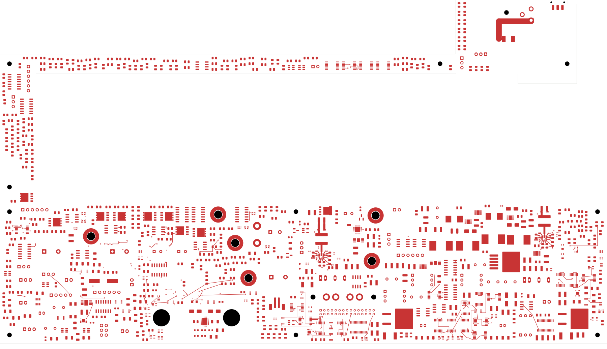
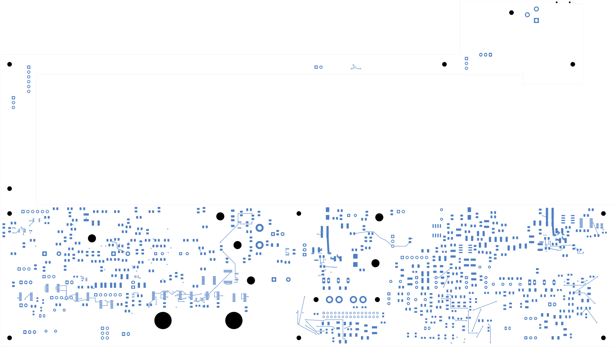

# Power/protection — U20 input and local return planes

Both U20 input branches, both PGND sides, the two bulk input capacitors and the
quiet BP5/AGND return now connect through local native-filled planes. The board
has **2,462 open connections**, seven fewer than the preceding revision, and
remains **not ready for fabrication**.
Open [power_protection.kicad_pro](power_protection.kicad_pro) in KiCad.

## Local layout

C204 moves from front (185,132), 90°, to back (173,132), 0°, beside the left input
branch. It retains its 22 µF 50 V X7R TDK C3225X7R1H226M250AC selection and uses
the identical existing C205 back-side footprint as its geometry template. C205
stays at back (184.3,136.65). All other components and all earlier tracks/vias
remain unchanged. The front-side left candidate was rejected because it
conflicted with P_J104; the selected back-side placement passes native copper
and independent courtyard/body/support/height checks.

The construction record's C204 rotation of 0° is relative to the C205 template;
the independent audit verifies the actual front-90° to back-0° change and both
native pad polygons. No component value or package substitution was made.

Sixteen new route sections add 16 tracks and thirteen 0.60/0.30 mm through vias.
The local front VIN connections are 0.35 mm; bulk-capacitor escapes are 0.8 mm,
paired-via buses 0.6 mm and short PGND approaches 0.4 mm. These dimensions are
not a completed ampacity or thermal qualification.

| Plane | Native filled copper | Connectivity checked |
| --- | --- | --- |
| In1 — PWR_AGND | One contiguous polygon, 450.693 mm² | Both PGND sides, both bulk-capacitor returns and the quiet return; seven new vias contact the fill |
| In3 — PWR_MODULE_FEED_IN | One contiguous polygon, 85.513 mm² | Both VIN sides and both bulk capacitors; all six new VIN vias contact the fill |

The In1 outline has a recess around the configuration return. The MODE-ground
via at (175.3,139.3) and its remote In1 trace remain outside the force plane;
the trace joins it near the BP5 ground via (182.8,141.1). A second quiet-return
via at (183.6,141.1) connects by a 0.4 mm front bus. The ground plane extends
beneath the 0.2 mm In2 output-sense path, excluding its own via clearances.
The audit measures zero uncovered sense-trace area under that definition.
Whole-field return impedance and noise remain unqualified.

This arrangement follows the local VIN/PGND, input-capacitor and BP5 return
principles in [TI TPS543620 sections 9 and 10.1](https://www.ti.com/lit/ds/symlink/tps543620.pdf).
The device requires at least 4 µF effective local ceramic input capacitance;
TI recommends at least 2 µF per side after derating. Exact effective capacitance
is **not yet verified**: nominal values and connectivity do not establish it.
See the [capacitor review](../two-board-input-capacitor-review-01/README.md).

## Verification

| Item | Result |
| --- | --- |
| Electrical components / footprints | 1,085 / 1,100 |
| Schematic pins / mapped pads | 3,418 / 3,479 |
| Tracks / through vias / filled zones | 2,256 / 180 / 4 |
| Native opens / connections closed this pass | 2,462 / 7 |
| Geometry / schematic parity / ERC errors | 0 / 0 / 0 |
| Retained isolated-reference warnings | 2 |
| Earlier physical connection groups preserved | All 3,207 |
| Minimum all-via drill-to-SMD gap | 0.165 mm |
| Existing U23 authored zones and saved fill | Both unchanged; fresh native refill gives identical canonical polygons |

The complete pin/net map, all values/packages, every earlier track/via and all
other component geometry are checked. New copper belongs to the intended local
VIN or ground groups. Both new planes have native 0.2 mm clearance and solid
via contacts; expanded capture polygons give a minimum foreign-copper gap of
0.199675 mm, consistent with their 0.001 mm capture error. Native DRC is clean.
The capture records 6,155 ordinary objects, four zones, 551 open nets and 3,013
open-net clusters. Native uncapped opens and the independent cluster-gap sum agree.

[Native checks](review.json) · [Independent audit](u20-input-audit.json)
· [Construction](u20-input-routing.json) · [Native fill](../two-board-power-u20-input-filled-01/local-plane-fill.json)
· [Full connectivity](../two-board-power-routing-inputs-2462-u20-input/capture.json)
· [Previously rejected source-net review](rejected-source-net-status.json)

## Actual copper views

| Front | Back, in top-view coordinates |
| --- | --- |
|  |  |

[Local front](plots/local-front.png) · [Local back](plots/local-back.png)
· [Local ground plane](plots/local-inner1.png) · [Sense trace](plots/local-inner2.png)
· [Local VIN plane](plots/local-inner3.png)
· [Six inner layers](plots/inner-contact-sheet.png) · [Visual review](plots/visual-review.json)

## Remaining work

Connect and qualify wider input/output/force-return distribution. Check exact
capacitor derating and stability, current capacity, thermal behavior, the enable
route's reference environment and complete enable electrical bounds. Review the
U23 quiet-return topology against the same BP5-entry criterion. Regroup AUX and
other critical circuits, then complete remaining power and signal routing.

The signal board still has 251 opens and its ESS codec footprint is missing.
Accepted stack/BOM/process requirements, reviewed manufacturing outputs and full
installed housing fit remain unfinished. Retired return studs need qualified
PCB replacement paths and updated bar/harness/support hardware. No fabrication
release, order or first-article hardware measurement is established here.
