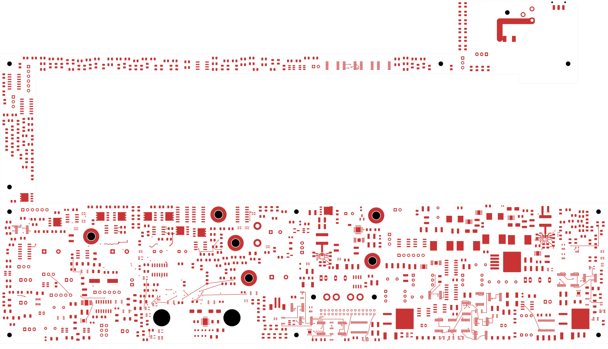
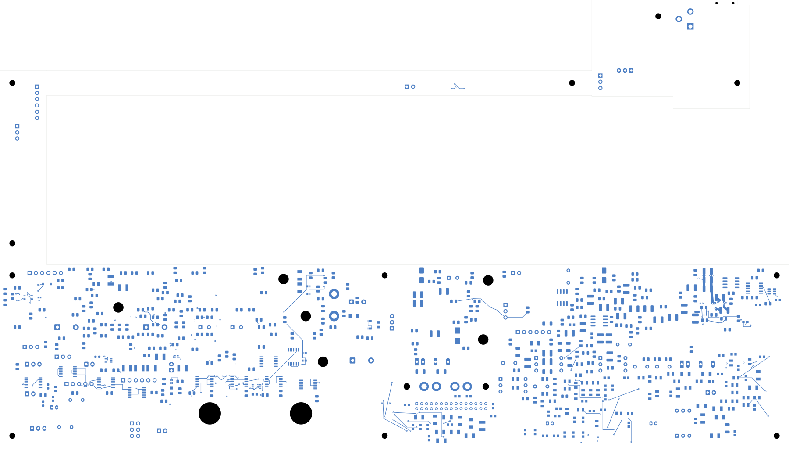

# Power/protection — U20 placement and local routes

The power board has **2,486 open connections** and remains **not ready for fabrication**.
Open [power_protection.kicad_pro](power_protection.kicad_pro) in KiCad.
This checkpoint groups U20's 20 local parts in the lower board arm, preserving
their board sides. It adds 22 front tracks forming 17 route sections and
16 real connections. Three obsolete internal connectors are retired separately,
removing six isolated terminal opens. No existing track or via is removed.

| Item | Checked result |
| --- | --- |
| Electrical components / total footprints | 1,085 / 1,100 |
| Schematic pins / mapped pads | 3,418 / 3,479 |
| Tracks / through vias | 2,199 / 151 |
| Open connections | 2,508 → 2,486 |
| Routed connections / retired terminal opens | 16 / 6 |
| Geometry / schematic parity / ERC errors | 0 / 0 / 0 |
| Retained isolated-reference ERC warnings | 2 |
| Retained physical connection groups preserved | All 3,240 |
| Minimum via drill-to-SMD gap | 0.165 mm |
| Existing U23 planes | Both unchanged, including saved fill |

[Native checks](review.json) · [Independent audit](u20-local-audit.json)
· [Construction and exact moves](u20-local-change.json)
· [Full connectivity capture](../two-board-power-routing-inputs-2486-u20-local/capture.json)
· [Previously rejected source-net review](rejected-source-net-status.json)

## Local regulator layout

U20 is at (177.5,136.5) mm and L20 at (177.5,127.4) mm. The 100 nF and
2.2 µF input capacitors form paired VIN/PGND branches beside the package.
Local routing connects these branches, BP5, bootstrap/BOOT_RETURN, the feedback
bottom/trim junction, and the switch node to L20. The external BOOT_RETURN net
remains distinct from SW; its manufacturer-declared internal bridge is retained
in the circuit model. No new via is needed for these front-side paths.

P_C201 changes from the earlier 0603 part to the existing P_C221 0402 template:
TDK C1005X7R1H104K050BB, 100 nF, 50 V, X7R. Its own reference, symbol path,
footprint/pad identities and pin nets are preserved. No other value or package
changes. The independent audit checks all 68 moved/replaced native pad instances
against the intended transforms, plus retained components, pin maps and copper.

The placement passes the recorded courtyard, board-edge, mounting and assembly
context screen. The E_C24 hold-up capacitor and nearby regulators remain fixed.
All changed or removed footprint copper is more than 2 mm from existing U23
zone outlines; saved fill and earlier zone contacts remain unchanged.
This limited screen does not establish complete installed housing fit.

## Retired internal connectors and outstanding return design

| Removed connector | Former terminals | Consolidation basis |
| --- | --- | --- |
| P_J20 | AGND analog return stud | Source and protection circuits now occupy the same PCB |
| P_J21 | AGND digital return stud | Source and protection circuits now occupy the same PCB |
| P_J106 | V2V5_AUX, AGND, RUN_BEFORE_FAN, P03_SOURCES_READY | Former source-to-protection control cable is internal to this PCB |

Every removed numbered pad was an isolated connection group. The two additional
unnumbered connector pads also disappear; no existing copper is pruned.
Remaining drivers and receivers retain their exact nets. The fan RUN gate,
source-ready monitor and module/negative-rail return isolation are preserved.
No external signal-board port is removed.

**The former analog and digital return-bar functions still require designed and
qualified PCB current-return paths.** Retiring the studs does not complete those
paths. Current capacity, voltage drop, shared impedance, noise and thermal
behavior must be checked, and the legacy bars, harnesses and support CAD must be
replaced in the assembly definition before release. Final physical interfaces
must be reconciled against that revised assembly.

## Actual copper views

| Front | Back, in top-view coordinates |
| --- | --- |
|  |  |

[Local U20 front](plots/local-front.png) · [Local U20 back](plots/local-back.png)
· [Six inner layers](plots/inner-contact-sheet.png) · [Visual review](plots/visual-review.json)

## Remaining work

Complete U20's bulk input and output connections, FSEL/MODE/enable, feedback-top
sense and quiet/force returns. Complete U23's wider source feed, AUX and other
critical circuit placement, and board-wide routing/planes. Effective capacitance,
inductor/current/thermal limits, loaded enable/startup/fault behavior and stability
remain unqualified. The [preceding enable review](../two-board-power-buck-enable-native-01/README.md)
records the limited shared-enable scenario screen and its assumptions.

The signal board remains at 251 opens with its ESS footprint missing. Approved
ESS package/land/stencil inputs, exact BOM, accepted stack and assembly process,
manufacturing outputs, final interfaces and full installed housing fit remain
release requirements. No fabrication order or release has been made.
