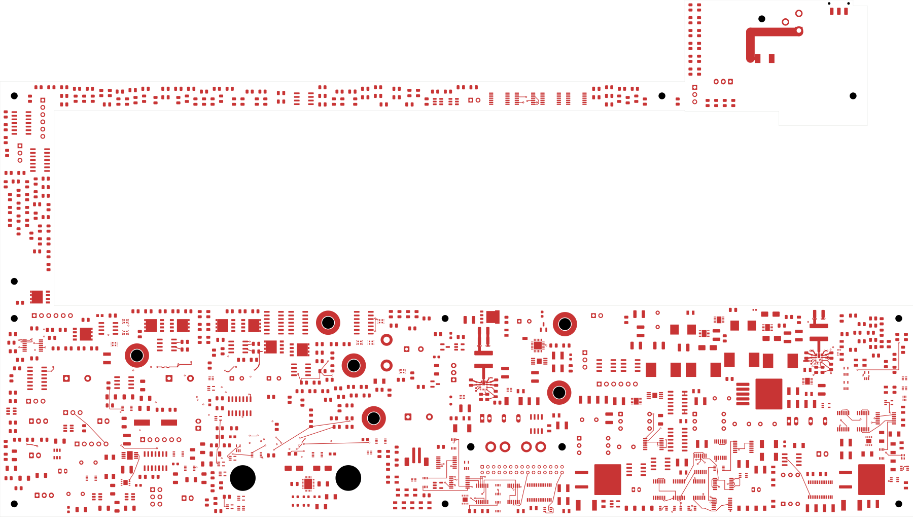
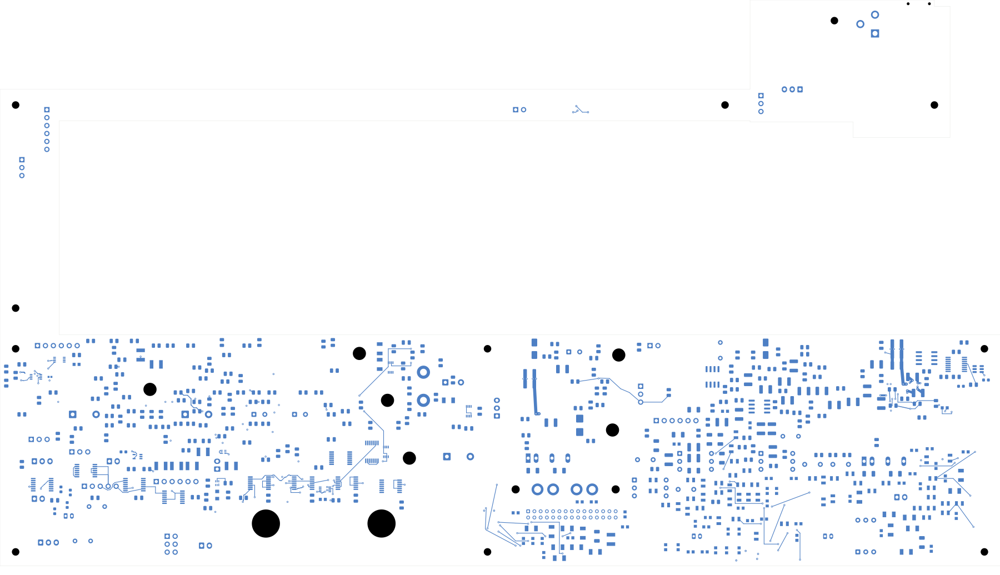

# Power/protection — U20 output bank

U20's four output capacitors now connect to L20 and the regulator's PGND.
The board has **2,478 open connections**, eight fewer than the preceding
checkpoint, and remains **not ready for fabrication**.
Open [power_protection.kicad_pro](power_protection.kicad_pro) in KiCad.

## Routing changes

C208/C209 remain on the front and C206/C207 on the back, at their existing
positions. One-millimetre tracks join each bank and connect the front bank to
L20. The output and ground layer transitions each use two conventional
0.60/0.30 mm vias, with 0.6 mm connecting tracks. The back-side ground trunk
returns to another pair of vias beside U20; a short 0.4 mm approach enters PGND.
Sixteen route sections add 17 tracks and six vias. No component, net, value,
package or existing copper changes.

An initial trial produced a native copper-sliver warning. The adopted revision
uses shared trunks and transverse via buses instead of overlapping diagonal
branches. It has no geometry findings; the failed trial remains unadopted.

| Item | Checked result |
| --- | --- |
| Electrical components / footprints | 1,085 / 1,100 |
| Schematic pins / mapped pads | 3,418 / 3,479 |
| Tracks / through vias | 2,216 / 157 |
| Native opens / connections closed this pass | 2,478 / 8 |
| Geometry / schematic parity / ERC errors | 0 / 0 / 0 |
| Retained isolated-reference ERC warnings | 2 |
| Earlier physical connection groups preserved | All 3,224 |
| Minimum all-via drill-to-SMD gap | 0.165 mm |
| Existing U23 authored zones and native fill | Both unchanged |

[Native checks](review.json) · [Independent audit](u20-output-audit.json)
· [Construction](u20-output-routing.json)
· [Full connectivity capture](../two-board-power-routing-inputs-2478-u20-output/capture.json)
· [Previously rejected source-net review](rejected-source-net-status.json)

The independent audit checks the actual saved native objects, every earlier
connection group, all component poses/values/packages, and the complete pin/net
map. All four positive capacitor pins share L20.2's group; all four returns share
U20.9's group. Every new track and via belongs to one of these groups. New copper
is more than 2 mm from both existing U23 zone boundaries; saved fill is unchanged.
The capture has 6,092 ordinary objects, two zones, 555 open nets and 3,033 open-net
clusters. The uncapped native count and independent cluster-gap sum agree.

## Electrical scope and remaining work

This establishes connected output-bank copper, not a qualified complete power
stage. Current capacity, via plating, copper thickness, temperature rise, return
impedance, capacitance under bias/temperature/aging, and loop stability still need
verification. The wider input, left/right PGND planes, quiet AGND connection,
feedback-top sense, FSEL/MODE and enable wiring remain incomplete.

The [TPS543620 datasheet](https://www.ti.com/lit/ds/symlink/tps543620.pdf), sections
9 and 10.1, calls for at least 4 µF effective local ceramic input capacitance,
split equally between the two input sides, and low-impedance VIN/PGND connections
using multiple vias and internal layers. The existing source allocation of
1 µF effective per 2.2 µF local capacitor does not by itself meet that per-side
target. Complete the bulk-input topology and reconcile exact parts/derating
before accepting the input network. The retained four nominal 47 µF output
capacitors also require exact MPN and effective-capacitance qualification.

The [preceding placement review](../two-board-power-u20-local-native-01/README.md)
records the retired P_J20/P_J21/P_J106 terminals. Their analog/digital return-bar
functions still need qualified PCB paths and updated assembly/harness/support
hardware. This local regulator return does not replace that board-wide work.

## Actual copper views

| Front | Back, in top-view coordinates |
| --- | --- |
|  |  |

[Local U20 front](plots/local-front.png) · [Local U20 back](plots/local-back.png)
· [Six inner layers](plots/inner-contact-sheet.png) · [Visual review](plots/visual-review.json)

Signal main remains at 251 opens with its ESS footprint missing. Other critical
circuit placement, all remaining routing, loaded startup/fault/thermal behavior,
approved ESS inputs, exact BOM, accepted stack/process, manufacturing outputs,
final interfaces and full installed housing fit remain release requirements.
No fabrication order or release has been made.
