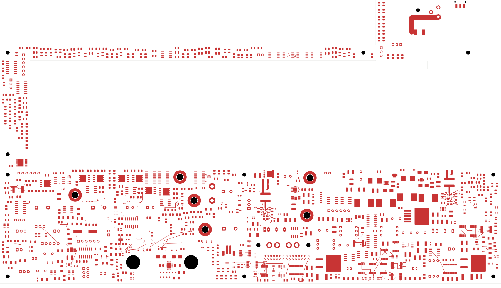
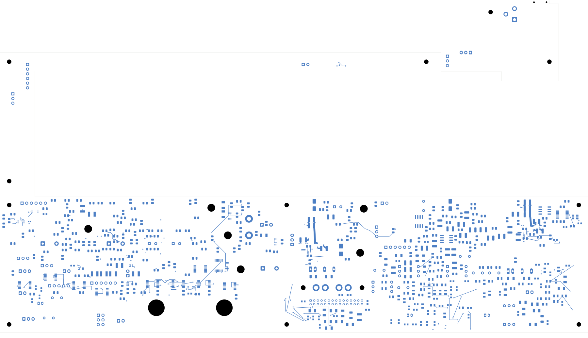

# Power/protection — U23 quiet-return correction

U23's MODE return now reaches the force-ground plane through the quiet link
near BP5, rather than directly through its remote via. A second BP5 return via
is added. **2,462 opens remain**; this corrects return topology without changing
the connection count. **Not ready for fabrication.**
Open [power_protection.kicad_pro](power_protection.kicad_pro) in KiCad.

## Change and verification

The In1 U23 ground outline has a recess around the MODE-ground via at
(292.8,129.8) and the remote configuration-return trace. The existing trace
still connects to the quiet-ground via at (299.25,132.2). It enters the force
plane only near that BP5 return point. A new 0.60/0.30 mm through via at
(300.05,132.2) joins it through a 0.8 mm long, 0.4 mm wide front trace.

This uses the same near-BP5 entry criterion as the preceding U20 layout,
following [TI's TPS543620 layout guidance](https://www.ti.com/lit/ds/symlink/tps543620.pdf).
It does not establish complete noise, impedance, stability or thermal performance.

| Item | Verified result |
| --- | --- |
| Geometry / schematic parity / ERC errors | 0 / 0 / 0 |
| Retained isolated-reference warnings | 2 |
| Native opens / new connections this pass | 2,462 / 0 |
| Tracks / through vias / filled zones | 2,257 / 181 / 4 |
| Electrical components / footprints | 1,085 / 1,100 |
| Schematic pins / mapped pads | 3,418 / 3,479 |
| Earlier physical connection groups preserved | All 3,200 |
| Minimum all-via drill-to-SMD clearance | 0.165 mm |
| U23 In1 ground copper | One contiguous polygon, 321.564 mm², previously 351.791 mm² |
| Direct ground-via contacts | 12 before and after; the remote MODE contact is replaced by the added BP5 via |
| Other three zone outlines and saved fills | Unchanged; fresh refill gives identical canonical polygons |

Every old track, via, pad and component pose/value/package is unchanged. The
complete pin/net map and all physical groups are preserved. The audit explicitly
verifies removal of the remote via's direct plane contact while retaining its
connection through the existing quiet trace. Every other earlier ground-via
contact remains. Both U20 planes and U23's VIN plane are unchanged.

The full 0.2 mm In2 sense-trace projection remains covered by In1 except its own
via clearances: uncovered area is zero under that definition. Native DRC is
clean; the minimum captured foreign-copper gap is 0.199675 mm with 0.001 mm
expanded capture polygons. Connectivity capture records 6,157 ordinary objects,
four zones, 551 open nets and 3,013 open-net clusters. Native uncapped opens and
the independent cluster-gap sum agree.

[Native checks](review.json) · [Independent audit](u23-quiet-audit.json)
· [Construction](u23-quiet-routing.json)
· [Native refill](../two-board-power-u23-quiet-filled-01/local-plane-fill.json)
· [Full connectivity](../two-board-power-routing-inputs-2462-u23-quiet/capture.json)
· [Previously rejected source-net review](rejected-source-net-status.json)

## Copper views

| Front | Back, in top-view coordinates |
| --- | --- |
|  |  |

[Local front](plots/local-front.png) · [Local back](plots/local-back.png)
· [Recessed ground plane](plots/local-inner1.png) · [Sense trace](plots/local-inner2.png)
· [Six inner layers](plots/inner-contact-sheet.png) · [Visual review](plots/visual-review.json)

## Remaining work

A [screened AUX placement candidate](../two-board-aux-cell-survey-01/README.md)
is available for implementation and native validation. It has not changed this
board. Wider supply/force-return distribution, enable reference coverage, actual
capacitor derating, current/thermal/stability and complete circuit checks remain.
The signal board has 251 opens and still lacks the ESS codec footprint.

Accepted stack/BOM/process requirements, remaining routing, reviewed manufacturing
outputs and full installed housing fit remain unfinished. Retired return studs
still require qualified PCB paths and updated assembly/harness/support hardware.
No fabrication release, order or first-article measurement is established here.
