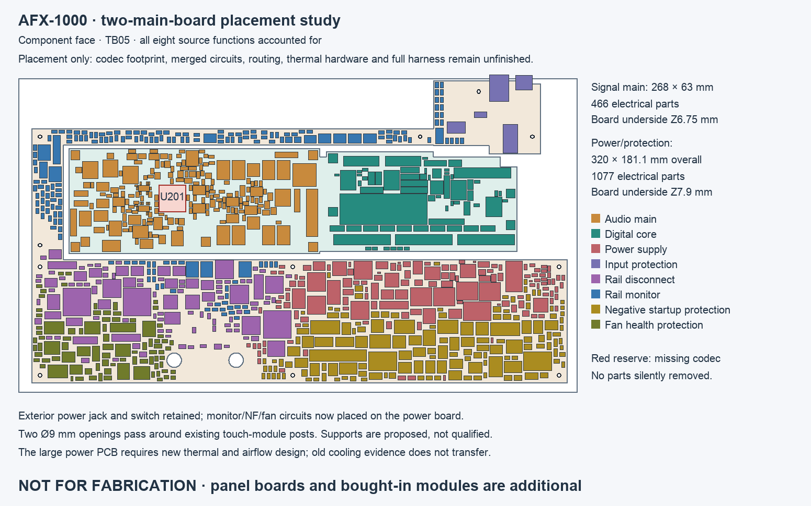

# TB05 — two-main-board placement candidate

All **1,543 currently placed electrical components** from the eight-board
development allocation have positions on **two main PCBs**. The final Linux
KiCad placement check reports zero native geometry/library findings and no
ignored rule categories on either board. This establishes a conditional
component-placement candidate, not complete housing fit, an integrated circuit
design or a fabrication release.

| PCB | Allocation | Electrical parts | Footprints including mechanical | Native opens |
| --- | --- | ---: | ---: | ---: |
| Signal main | Audio, converter reserve, processor carrier, controls and LED drivers; 268 × 63 mm overall, underside Z6.75 | 466 | 477 | 1,190 |
| Power/protection | Supply, inlet, disconnect, monitoring, NF and fan functions; 320 × 181.1 mm overall, underside Z7.9 | 1,077 | 1,092 | 2,634 |

The power PCB is one connected C-shaped outline around the signal PCB. Its
rear branch reaches the existing power inlet. Both boards use a provisional
1.6 mm nominal thickness and the inherited eight-copper-layer template for the
placement check; neither stack is a selected manufacturing construction. The
independent receiving screen uses a 1.44–1.76 mm thickness interval and ±0.2 mm
board-height allowance. The exterior power jack and switch retain their native
XY positions and original Z7.9 board datum.

The missing ESS U201 footprint is **not** among the 1,543 placed parts. Its
16 × 16 mm planning reserve is shown in red; no land pattern has been invented.
Panel boards, the angle-sensor allocation and bought-in modules remain additional
to the two custom main PCBs. The processor module's existing receiving envelope
is retained on the signal board.

[Underside receiving view](placement-B.png) · [Front SVG with component tooltips](placement-F.svg)

## Reviewable CAD and evidence

- [Signal-main KiCad PCB](../two-board-placement-cad-03/signal_main.kicad_pcb)
  and [project](../two-board-placement-cad-03/signal_main.kicad_pro).
- [Power/protection KiCad PCB](../two-board-placement-cad-03/power_protection.kicad_pcb)
  and [project](../two-board-placement-cad-03/power_protection.kicad_pro).
- The CAD folder includes 56 bundled, source-bound footprint libraries and
  `fp-lib-table`. Open the project from that folder; the libraries are local.
- [Final native checks](../two-board-placement-native-04/review.json): both
  boards load, zero geometry violations/warnings, all configured categories
  enabled. Both are intentionally unrouted: zero tracks/zones, 3,824 total opens.
- [Independent receiving audit](../two-board-placement-05/independent-placement-audit.json):
  2,116 component, tail and mounting receiver entries; no reported context,
  cross-board, same-board body/tail or floor findings under the stated bounds.
  The later native check additionally covers the opposite-face courtyards and
  drilled-hole geometry that the original envelope audit did not cover.
- [Source preservation](source-preservation.json): all 1,556 retained source
  footprints and 5,327 pads match their original values, angles, faces and intrinsic
  geometry. Missing-pad, wrong-source-net and shifted-placement mutations are
  rejected. Twenty-two obsolete separate-board mounting footprints were retired;
  eleven new power mounts and two touch-post clearance holes were added.
- [Explicit part/net mapping](../two-board-placement-cad-02/part-and-net-map.json),
  [complete placement](../two-board-placement-05/placement.json) and
  [source/receiving capture](../two-board-placement-05/capture.json).

## What changed and what was preserved

The signal board keeps every existing audio/digital footprint's XY position,
angle and face, with a new joining strip and shared height. The previous upper
monitor board and vertical NF/fan cards are replaced by placements on the power
PCB. No electrical component or internal connector was silently removed to make
the packing fit. The proposed touch-post openings are Ø9 mm around the two
existing post centres; their actual dimensional and assembly contract remains
to be qualified.

The expanded review found that inlet J3's complete receiver and the old H1 head
receiver overlap the retained service-USB allocation. J3 was relocated and the
old inlet mounts retired; the exterior jack/switch remain fixed. The NF force
pair's J4 moves +1.5 mm and its H102 strain post +3 mm within the relocated group
to clear the conservative receiving bounds. The changed force/strain geometry
requires a new wiring and retention review.

Native KiCad caught six underside courtyard overlaps and a drilled-hole clearance
issue missed by the first packing model. TB05 includes both-face courtyards and
every NPTH reserve and repacks the parts. Those actual native findings are clear
in the final run. Earlier failed captures and native results remain intact.

General copper clearance remains 0.20 mm. The only 0.15 mm package-internal
exceptions are the exact pre-existing audio VSSOP and power TI RPY rules, with
their reference names mapped to the new prefixes. The original power board's
0.16 mm general rule was not used to weaken the new 0.20 mm rule. No category was
suppressed. Missing-library warnings were resolved by bundling the actual source
libraries, not by disabling library checks.

Every source circuit retains its own explicit net namespace. For example, audio
AGND and power AGND are not automatically joined. This prevents accidental shorts
while the true inter-board wiring is translated into the integrated schematics.
It does **not** establish electrical equivalence of the complete unit. The old
routed copper is not copied and the merged schematic does not exist yet.

## Limits that govern the result

This is a deterministic mechanical packing study. The power/protection placement
has not yet restored or qualified every original decoupling, feedback, Kelvin,
switching-loop and timing relationship. Local circuit groups need electrical
placement review before routing. Keeping all pads/nets preserves source identity;
it is not proof of circuit performance in the new placement.

Component, mating and tail heights include inherited project allocations and
explicit new provisional bounds. They are not all supplier-approved maxima.
The audio 3.2 mm tail projection remains a provisional assembly requirement.
The 0.25 mm context comparison and 0.30 mm packing spacing are design assumptions.

The receiving checks include the retained controls, repaired rear jack-height
scenario, service-USB allocation, four panel PCB slabs, touch-module reserve and
proposed mounts. They do **not** include a complete new shell/boss/duct/thermal
assembly Boolean model, all actual connector plugs and wire bends, removal
trajectories, or a mechanical strength analysis. The long narrow rear power-board
strip particularly needs a support/stiffness review. PCB material is allocated
within the housing plan; full installed fit remains unverified.

The larger power board crosses former airflow space and changes source-to-base
thermal paths. Old heat-spreader, busbar and airflow proofs do not transfer.
Both the support structure and cooling arrangement require redesign and a new
coherent full-unit check. No enlarged exterior housing has been adopted.

## Next engineering work

1. Build the two integrated schematics with a reviewed interface/pin map. Preserve
   isolated references, enable/fault paths and analog returns; remove only truly
   redundant internal connectors after checking every connection.
2. Restore and verify each local circuit's placement constraints on the new boards,
   and choose the stack/process with the fabricator. Obtain the approved ESS
   package, land and stencil inputs before placing U201 and its dependent parts.
3. Design the current support, thermal and airflow hardware; add actual mates,
   harnesses, service paths and tolerances; run the complete native assembly check.
4. Freeze mechanical interfaces, then route and renew ERC/DRC, power/return,
   signal-integrity and manufacturing-output reviews.

The selected eight-board development sources, their routing checkpoints and
`current-readiness.json` remain unchanged as references. This two-board candidate
is the new consolidation study; it is not a fabrication package or order.
