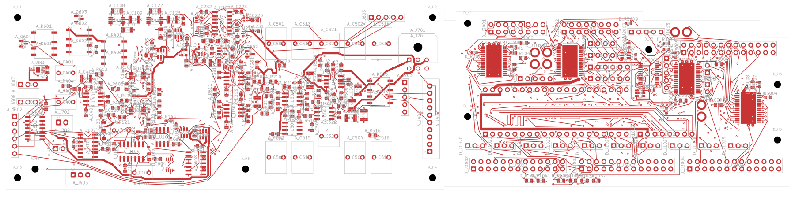
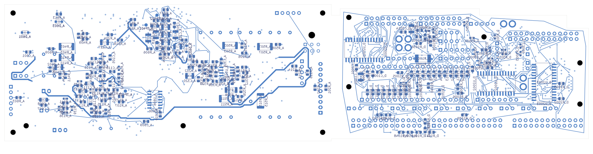

# Integrated signal main — partial routing checkpoint

The 268 × 63 mm signal PCB now has an integrated nine-sheet circuit, retains
the **Daisy Seed 3** module in its 40-pin socket, and carries the source audio
and digital routing. **It is not fabrication-ready.** The companion power PCB
remains a placement study with unresolved electrical integration.

Open [signal_main.kicad_pro](signal_main.kicad_pro) in KiCad. The schematic,
PCB, custom rules and local symbol/footprint libraries are included here.
Do not fabricate from this checkpoint or the earlier placement ZIP.

| Check | Result |
| --- | --- |
| Schematic electrical components | 467, including the unplaced codec |
| Placed electrical footprints | 466, plus 11 mechanical footprints |
| Source schematic pin entries checked | 1,680 |
| Declared audio/Daisy header-pin joins | 19 pairs forming 16 shared nets |
| Restored source copper | 5,767 segments and 917 vias |
| Original physical pad groups preserved | 406 audio and 270 digital |
| Native geometry / ERC findings | 0 / 0; no ignored categories |
| Schematic-to-PCB findings | 1: missing ESS A_U201 footprint |
| Native open connections | **251** |

The open count is the original 208 audio plus 27 digital opens, plus the
16 new shared nets that still need physical connections between the sections.
This is a routing starting point, not 251 newly solved connections. The bridge
has no completed signal routing or continuous shared ground reference yet.

[In1](plots/inner1.png) · [In2](plots/inner2.png) · [In3](plots/inner3.png) ·
[In4](plots/inner4.png) · [In5](plots/inner5.png) · [In6](plots/inner6.png)

## Circuit and copper evidence

The [pin audit](../two-board-signal-native-03/circuit-audit.json) compares the
native exported connectivity partition, values and assigned lands against both
source circuits plus the [explicit interface joins](../two-board-signal-native-03/interface-joins.json).
It rejects a swapped BCLK/WS pair, an omitted CODEC_RUN join and an undeclared
join between the two existing 5 V inputs. Both existing 5 V inputs remain
separate pending the final distribution design. All electrical connectors are
retained; obsolete internal headers have not yet been removed.

Two nonphysical power flags became redundant after integration: the external
audio 3.3 V assertion is superseded by Daisy U1001.38, and the duplicate digital
ground assertion is superseded by the retained audio assertion. Their own
orphan labels were removed. No physical power component or protection circuit
was deleted, and no ERC category was suppressed.

The [native review](review.json) checks the actual refilled PCB, schematic
parity and ERC. The independent [copper-retention audit](copper-retention-v2.json)
checks all 1,631 source pad instances, every original physical connection group
and every track/via's translated position, layer, width and drill geometry.
There are no regressed source connections or missing/extra copper objects.
All eight actual copper views were [visually inspected](plots/visual-review.json).

The first plane-conversion trial is rejected: four digital planes lost their
net assignment and it produced 383 opens and 119 warnings. The corrected
candidate explicitly restores the zone assignments. The independent audit
detects the failed trial's two regressed digital connection groups. The first
retention audit used a deprecated layerless via-width API; `copper-retention-v2.json`
supersedes it with the explicit-layer call.

## Remaining release work

- Obtain the approved ES9292QPRO package, land-pattern and stencil drawings;
  place and integrate A_U201. Its existing symbol is not a qualified footprint.
- Complete the power schematic using the [current-pin interface review](../two-board-power-interface-audit-01/README.md),
  resolve NF buffering/fault/clamp/auxiliary paths, then restore critical
  switching, decoupling, Kelvin and timing placement before routing that board.
- Finalize the two-board power/control interface and remove only verified
  redundant connectors. Route the remaining signal connections with an actual
  return-path and timing/noise review.
- Select and accept the fabrication stack and assembly process. This board
  uses the provisional eight-layer placement template; copying four-layer
  audio copper into named layers does not qualify its new stack or performance.
- Complete the revised supports, cooling, airflow, real connector mates and
  harness bends, and run the full tolerance-aware installed-fit check.
- Close source, fault, thermal and electrical design checks; then generate and
  inspect a coherent manufacturing package and first-article bring-up plan.

The DWGs.User warning inherited from the placement board still marks it as
unrouted/not for fab; this checkpoint has partial inherited copper only.
No fabrication files, manufacturing acceptance, order or physical qualification
are implied by a clean geometry/ERC result. Earlier selected eight-board
development checkpoints remain unchanged.
