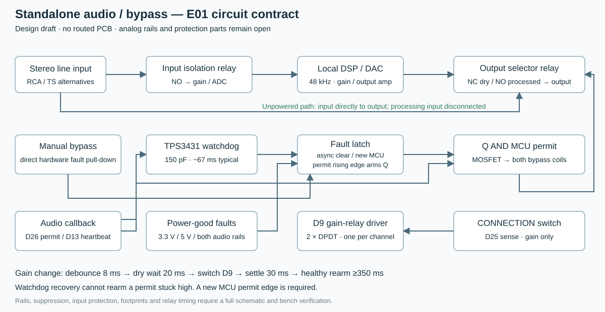

# E01 standalone audio and power design

Preserved from `hardware/electronics/README.md` during the folder reorganisation. Current setup and status are in the [repository guide](../../README.md). Existing citations are retained without new verification.

[E18 digital inputs](../../hardware/electronics/control_inputs/README.md) now adds a routed64 ×54mm
three-expander input hub for F04's32 front controls and four external rear/status
inputs. All15 component contracts, native ERC/DRC/parity and open-connection
checks pass; the saved board has424 segments,62 vias and a filled AGND plane.
Actual PCB-derived bounds pass A04's241-reserve and native solid-intersection
checks. This implements the digital input subassembly; pots, LEDs, touch/angle
circuits, complete carrier routing and physical validation remain unfinished.

Current ADC-input circuit work is [E12](../../hardware/electronics/adc_driver/README.md): high-impedance
buffers, remote-feedback differential drivers, reference-half servos and local
negative bias. Its79-component schematic passes ERC and exported pin/value,
AC/DC/corner/interface checks. The real ADC load, loop stability, complete
protection/weighted noise, PCB and physical
validation remain open. Earlier E10 discussion below describes its stage boundary.

[E13](../../hardware/electronics/rail_monitor/README.md) now implements the eight UV/OV rail and bias
windows feeding E09 PRE_ANALOG_OK. Native ERC, 181 exact exported contracts,
73,728 allocated threshold corners, 131,072 powered logic combinations and
fresh E09/E11/E12 interfaces pass. [F03](../../hardware/firmware/EXTERNAL-CONVERTER.md) adds
bounded delayed-power startup probing; both ARM profiles and eight host suites
pass. The monitors do not generate rails or disconnect excessive voltage. Main
power generation/protection, integrated PCBs, placement and physical tests remain
open. [E14](../../hardware/electronics/power_supply/README.md) now adds a native main supply-generation
candidate with separate ±22 V/±17 V raw rails, precision ±19 V/±12 V final rails
and analog/digital5V. With E17's digital-source trim, its157-part schematic passes ERC, exact exported topology,
allocated accuracy/current/dropout and hypothetical SET-loop checks. The ±12 V
budget includes the actual amplifier package count and E08 load model.
[E16](../../hardware/electronics/input_protection/README.md) extends the E15 eFuse/reverse-blocking
candidate to48 parts with an independent fast-OV shutdown comparator and delayed
auxiliary PG. It retains the E14 power-good guard. ERC, exact contracts,
80 eFuse/2,048 fast-OV threshold corners,11 conditional settled states and fresh
supply-interface checks pass. [E17](../../hardware/electronics/rail_disconnect/README.md) now adds162 parts
for six rail switches and an independent OV/reference interlock. ERC,16,384
allocated threshold corners,512 powered interlock combinations,768 ideal diode
direction cases and fresh source/load interfaces pass. Switches sense source
rails and do not require protected supplies to start. Actual fault-charge and
switch timing/current, fuse/TVS coordination and supply
stability/ripple/thermal, PCB/placement and physical tests remain unfinished. Historical stage descriptions
below retain their original snapshot scope.

**Audio architecture update:** the E04 screen below does not approve the onboard
Seed3 converter or the E01 resistor network for the reference-performance unit.
Use that module/firmware for bring-up. Evaluate external conversion and revised
analog stages before completing the carrier. The E02/E03 independent bypass
work is retained as historical/default-onboard bring-up. The external profile
now uses the [E11 sequencer](../../hardware/electronics/sequenced_bypass/README.md) and F03 firmware.

The [E05 native output stage](../../hardware/electronics/output_stage/README.md) now implements the
post-receiver drivers, separate coupling/bleed branches and gain-output relay.
It supersedes the E04 output-resistor starting values by including the actual
bleed load. It does not complete the converter/receiver, input range, power,
all-four-rail supervision or the other system PCBs. A03/E07 places its eight
film capacitors and remaining output components in revised internals. The
output subassembly is routed, with native DRC/parity passing and zero open
connections; modeled clearances pass. Physical fit and audio remain unverified.

The [E08 native DAC I/V and receiver](../../hardware/electronics/dac_receiver/README.md) adds the ESS
reference-derived I/V/common-mode topology, a differential low-pass receiver,
film DC blocking and a FET buffer for the E05/E07 interface. Its 60 components
pass native ERC and independent exported pin checks; loaded ideal analysis
includes the actual output-board input load. Raw converter scale and power-fault
protection are unresolved, and this circuit has no PCB or enclosure placement.
Its one-second settling requirement is addressed by the E09 timer schematic
and F01 firmware profile; neither has physical validation. The prototype's
350 ms rearm delay alone is insufficient after a converter DC-state change.

The [E09 converter-core schematic](../../hardware/electronics/converter/README.md) adds the ES9292 pin
contract, local regulators, codec-master clock and hardware qualification timer.
The default I²C address is 7-bit 0x18; the datasheet's 0x30/0x31 examples include
the read/write bit. Native ERC and 256 powered logic cases pass. The proposed
SAI2/pin reassignment now has a separate [F01 firmware profile](../../hardware/firmware/EXTERNAL-CONVERTER.md)
that cross-compiles and has host policy checks. The codec's dimensioned
QFN/exposed-pad drawing is still needed; its footprint remains unassigned.
No E09 board or full converter/input/power placement has been completed.

The [E10 input-range preamplifier](../../hardware/electronics/input_range/README.md) now implements passive
master attenuation before an AC-coupled low-voltage FET buffer, plus the second
stereo gain relay. This replaces the prospective high-voltage input-buffer
topology discussed below; the E04 record remains a historical screen. E10 passes
native ERC, loaded AC/allocated DC checks and passive corners. It does not
implement the raw ADC driver/bias/protection or establish converter full scale.
An independent input-isolation/precharge sequence is also required: E02/E03
currently energize input isolation and wet-output selection together, which
does not provide the new input-settling interval. Those hardware/firmware
changes are implemented in the E11 schematic/F02 firmware; all E10 PCB/enclosure
placement and physical precharge validation remain unfinished.

The [E11 sequencer](../../hardware/electronics/sequenced_bypass/README.md) replaces E02/E03 for the external
profile. It adds an independent input coil driver, a counter-based settling timer,
both-edge gain reset, startup guard and INPUT_READY feedback. K1 stays dry during
input settling; manual bypass leaves a healthy K2 input connected. Its55-component
native schematic passes ERC,256 powered cases,seven stateful sequences and fresh
E10/E05/E09 interface checks. F02 waits for input status and masks unsettled ADC
samples before DSP histories. Eight host suites and both ARM builds pass. Exact
parts, timing allocations, PCB/placement and physical bypass/audio remain open.

This is the circuit design basis for the standalone unit. It contains calculated
gain/headroom requirements, a draft gain network, an independent bypass/watchdog
contract and a named-terminal connection list. The full audio/power schematic
and carrier PCBs remain incomplete. Keep the A02 carrier shapes as placement reserves.

The [E02 native watchdog/driver schematic](../../hardware/electronics/bypass/README.md) supersedes the E01
watchdog and manual-switch circuit below. It adds local 3.3 V/5 V supervisors,
Schmitt-input logic, a closed process-enable loop, latch-Q feedback and selected
drain clamps. Its native ERC/pin checks and 25 ideal fault cases pass; layout,
analog-rail supervision and physical fault response remain unverified.

The [E03 stereo contact schematic](../../hardware/electronics/audio_bypass/README.md) adds the actual
manufacturer pin assignments for output selection and processing-input
isolation. Its native ERC, four settled contact cases and fresh E02 interface
check pass. It supersedes the missing contact-pin portion of this E01 contract;
analog gain stages, power, PCB layout and physical audio testing remain open.



Run `python3 -m hardware.electronics.design` to regenerate the
[line-level calculations](../../hardware/electronics/generated/line-levels.json),
[ideal fault-latch scenarios](../../hardware/electronics/generated/bypass-logic.json),
[named-terminal list](../../hardware/electronics/generated/bypass-terminals.csv) and diagram. The script uses
only Python's standard library. The logic model does not simulate electrical
behavior, relay timing or power ramps.

## Connection levels and power constraint

The reference manual distinguishes −10 dBV send/return and +4 dBu master levels,
with input impedance at least 22 kΩ and a 10 kΩ output load. Its CONNECTION switch
changes input/output gain. It does not select wet-only DSP routing. See the
[manufacturer's manual download page](https://support.pioneerdj.com/hc/en-us/articles/4404659858201)
and the manufacturer-authored [operating instructions, pages 11 and 25](https://www.bax-shop.nl/downloads/products/9000-0004-1041/rmx-1000_manual_en_fr_de.pdf).

Use 20 dB headroom **in both modes as a project design target**. The reference
specification's single 20 dB figure does not establish separate measured clipping
levels in each mode. This project target is deliberately explicit.

| Mode | Nominal level | Target maximum sine RMS | Target peak |
| --- | ---: | ---: | ---: |
| Send/return | 0.316 V RMS | 3.162 V RMS | 4.472 V |
| Master | 1.228 V RMS | 12.283 V RMS | 17.371 V |

For the Seed3's nominal 1 V RMS converter reference, the ideal input attenuations
are 0.3162 and 0.08141; output gains are their reciprocals. Nominal line level
therefore sits around −20 dBFS. Confirm the actual ADC/DAC scale and codec setup
on the module before accepting gain or clipping measurements. The
[Seed3 datasheet](https://daisy.nyc3.cdn.digitaloceanspaces.com/products/seed3/Daisy_Seed3_datasheet.pdf)
provides the analog interface and nominal levels; its example circuit alone does
not meet this project's complete mixer-level requirement.

A single 5/9/12 V analog supply cannot meet the master target. With an assumed
2 V amplifier swing reserve, 5% rail tolerance and 100 Ω output resistor into
10 kΩ, even ±18 V does not pass the screening calculation. ±22 V passes that
voltage calculation. This **does not select an amplifier or prove noise/THD**.
OPA1652/OPA1656 cannot run on ±22 V: their recommended total supply limit is 36 V.
Their much smaller typical output swing must not be used as a guaranteed
production margin. See [OPA1652](https://www.ti.com/product/OPA1652) and
[OPA1656 electrical characteristics](https://www.ti.com/lit/ds/symlink/opa1656.pdf).

A high-voltage candidate such as [OPA551](https://www.ti.com/lit/ds/symlink/opa551.pdf)
has enough supply range, but its noise, closed-loop bandwidth, thermal behavior
and stability need analysis at the proposed gain. It is **not selected for the
audio BOM**. Do not trade away the existing noise/headroom targets by silently
substituting an arbitrary high-voltage amplifier.

Power design must consequently compare a regulated bipolar analog supply with
a suitable output topology before finalizing the adapter or DC jack. Keep a
separate regulated 5 V digital/LED/relay rail; do not put the MCU, touch electrodes
or LED returns on the quiet analog return path. Tie ground domains according to
the module and converter requirements. Isolation ratings alone do not establish
audio grounding or switching-noise performance.

## Draft switched gain network

**Rejected as the reference-performance gain network by the E04 noise screen.**
The following values preserve the earlier draft and its calculations; they are
not a recommended population list. The proposed replacement has separate
consumer/master output drivers and a separately switched stereo input range.

Use one DPDT gain relay per channel, both controlled by **D9 through a coil
driver**. Low/default selects Master; high selects Send/Return. D25 only senses
the rear CONNECTION switch. Both audio stages invert, preserving overall polarity.

| Stage | Always-connected path | Master branch, coil off | Send/return branch, coil on |
| --- | --- | --- | --- |
| Input | Rin 32.4 kΩ; Rf 10 kΩ | 3.48 kΩ shunt across Rf via NC | NC opens; Rf stays 10 kΩ |
| Output | Rin 10 kΩ; Rf 127 kΩ | NO open; Rf stays 127 kΩ | 43.2 kΩ shunt across Rf via NO |

The fixed feedback resistors remain connected throughout relay motion. Input
gain is approximately 0.30864 / 0.07968 and output gain 3.2235 / 12.7 for
Send/Return / Master. Unloaded unity errors are about −0.044 / +0.103 dB before
calibration; output load changes those figures. This is a resistor-network draft:
DC coupling/capacitors, protection, compensation, resistor tolerance/noise, codec
input impedance and amplifier supply domains still need a full schematic.
Do not populate these values on an unreviewed board.

Firmware immediately removes processing permit on a switch edge, debounces for
8 ms, allows 20 ms for dry-bypass release, changes D9, and waits 30 ms for gain
settling. Processing then needs the existing 350 ms healthy interval. Bounce and
delayed polling restart/extend the guarded sequence. The actual relay release,
bounce and suppression network must fit these intervals on the bench.

Wet-only operation, if later offered for parallel auxiliary buses, needs its own
setting. The current standalone default retains dry audio in normal DSP routing.

## Independent bypass and fault latch

Reserve **two G6K-2F-Y DC5 bypass relays**, in addition to the two gain relays:

- Output relay: left/right common contacts to output; NC to dry input; NO to
  the processed output stage. Never join the dry and processed outputs.
- Input isolation relay: common contacts to the protected processing inputs;
  NO to line input; NC left disconnected. This removes the unpowered analog
  circuitry from the dry path instead of relying on its unpowered input behavior.

Both bypass coils energize together. Grounds remain continuous; this is not
galvanic isolation. Input coupling/protection must tolerate hot-plug and relay
engagement transients. Verify NC dry continuity and processing-input isolation
with power disconnected. Four relays use about 84 mA at 5 V when all energized;
use actual coil tolerance and supply limits in the final budget. The
[manufacturer G6K drawing](https://omronfs.omron.com/en_US/ecb/products/pdf/en-g6k.pdf)
specifies the family dimensions, coil data and nominal switching limits.

Use [TPS3431](https://www.ti.com/lit/ds/symlink/tps3431.pdf) at 3.3 V, EN and SET1
high. A 150 pF C0G capacitor at CWD gives approximately 66.6 ms nominal timeout.
The screening interval uses a conservative ±15% timing allowance and ±5% capacitor
tolerance, about 56.1–77.3 ms, excluding stray capacitance. The callback toggles
D13 each 128-frame block; falling edges arrive every 5.33 ms at 48 kHz.

**WDO alone is insufficient.** After a timeout, its reset interval can end and
the output can recover even while the MCU permit is stuck high. Use a
[SN74LVC1G74](https://www.ti.com/lit/ds/symlink/sn74lvc1g74.pdf) edge-armed latch:

- D and PRE_N high; CLK = D26 processing permit; CLR_N = FAULT_N.
- FAULT_N has a 4.7 kΩ pull-up and wired open-drain fault sources: watchdog WDO
  and ENOUT, the manual bypass contact, and the rail supervisors.
- Q AND D26 through [SN74LVC1G08](https://www.ti.com/lit/ds/symlink/sn74lvc1g08.pdf)
  drives the bypass-coil MOSFET. D26 and the MOSFET gate each have pull-downs.
- A fault asynchronously clears Q. WDO recovery leaves Q low until the MCU
  produces a new permit rising edge. Dropping D26 turns the coils off immediately.
- All logic ICs need local 100 nF decoupling. Q_N is unused. Package pin numbers,
  recovery/setup timing and footprints must be checked in the EDA schematic.

An [AO3400A](https://www.aosmd.com/sites/default/files/res/datasheets/AO3400A.pdf)
is a working driver candidate with on-resistance specified at 2.5 V gate drive.
Use a gate resistor and fast coil-energy suppression. Suppressor parts, pulse
energy, worst-case drain voltage and measured relay release remain open; a plain
flyback diode can extend release. The named-terminal CSV intentionally omits
that incomplete suppression circuit and all relay contact pin numbers.

Rail supervisors must monitor 3.3 V, 5 V **and both analog rails**, independently
of firmware. Their open-drain faults must clear the latch before any analog
stage leaves its valid operating range. Negative-rail monitoring requires a
proper interface; do not connect a negative supply to a logic input. Exact parts
and thresholds await the selected analog supply. A direct manual bypass contact
clears FAULT_N; a separate pole supplies D0 sense.

## Before PCB layout or fabrication

1. Select the analog amplifier/topology against headroom, noise and stability;
   settle the bipolar supply, regulators and rail supervision.
2. Complete stereo input/output protection, grounding, coupling, RF filtering,
   compensation, relay suppression and connector selection/normalling. Separate
   RCA and TS input sources must never be shorted together. Output connector
   pairs share one signal; their **combined** load must meet the design limit.
3. Convert the circuit contract into an EDA schematic, verify package pins, run
   ERC, calculate tolerance/noise/thermal budgets, and review startup/brownout.
4. Place real footprints and connectors against the CAD before routing. The
   E07 output subassembly occupies 82 × 34 mm and is now routed. Its 41 parts
   clear modeled internals, but the converter/input, bypass/watchdog and final
   power PCBs still need placement/routing. The 78 × 38 mm power reserve may
   need moving/enlarging as that circuit is completed.
5. Bench measure gain, frequency response, clipping, noise/THD, DC/transients,
   capacitive-load stability, relay timing and every bypass fault/rearm case.

The generated calculations and ideal latch scenarios are useful design checks.
They do not establish 20 dB measured headroom, reference-level S/N or a verified
physical fault response.

## E04 converter, gain and noise screen

Run the following command for the [calculated report](../../hardware/electronics/generated/audio-budget.json).
The [source record](../../hardware/electronics/audio-sources.json) identifies the primary datasheets and
download hashes. No firmware or CAD geometry changes are implied by this screen.

    python3 -m hardware.electronics.audio_budget

For a neutral unity-through path, independent ADC and DAC noise powers add.
Twenty dB of input headroom places nominal audio 20 dB below converter full
scale. The following figures use the manufacturers' typical A-weighted dynamic
range/SNR figures, with compatible weighting assumed between stages:

| Converter configuration | ADC / DAC figure | Combined full-scale figure | Converter-only S/N at nominal level |
| --- | --- | --- | --- |
| TAC5242, single ended, 3.3 V | 110 / 111 dB | 107.46 dB | 87.46 dB |
| TAC5242, differential, 3.3 V | 119 / 120 dB | 116.46 dB | 96.46 dB |
| ES9292PRO, AVCCH 3.3 V | 128 / 128.5 dB | 125.23 dB | 105.23 dB |
| ES9292PRO, AVCCH 4.5 V | 128.5 / 130 dB | 126.18 dB | 106.18 dB |

These are conditional noise-budget calculations, not measured Seed3 figures or
a formal comparison with an original RMX. The Seed3's hardware straps and full
analog transfer remain unverified. Even the optimistic differential TAC5242
screen has no budget for our 102/98 dB nominal-level targets with 20 dB headroom
in both modes. It is consequently not approved as the final converter path.
Reference weighting/filter, operating state and clipping conditions must be
established when comparing actual units. The preferred 110 dB nominal S/N
remains an aspiration; none of these codec screens meets it.

The E01 resistor network also requires replacement. At 25°C, ideal flat gain and
20 Hz–20 kHz rectangular bandwidth, its resistor noise alone gives approximately
9.37 µV RMS / 90.57 dB in Send/Return and 26.57 µV RMS / 93.30 dB in Master.
Those figures are **unweighted**, exclude amplifier/converter/supply noise and
do not establish an A-weighted measurement. They reveal a substantial noise
cost before any real active circuit is added. A finished circuit needs integrated
noise spectra and its actual filter response; do not mix these unweighted figures
with the A-weighted codec figures in a claimed end-to-end result.

### Prospective replacement

ES9292QPRO is the external-converter candidate. Its public revision-0.1 datasheet
provides pin functions, power sequencing, registers and reference stages; the
manufacturer announces production. Distributor supply for this build is still
unconfirmed. It needs its own differential analog board, quiet 3.3 V/4.5 V
supplies, clocking and firmware adapter. The existing Seed3 onboard-codec build
does not operate this part.

In the 4.5 V mode, the calculation leaves at most 1.97 µV RMS of independent
additional analog noise at the Send/Return output, or 14.24 µV in Master, before
the minimum targets are missed. These are budgets, not predicted stage noise.
The EVM measurements may already include parts of its reference analog stages;
do not double-count them when building a complete noise model.

The datasheet specifies about 260 Ω input impedance and 390 Ω output impedance,
each with ±15% variation. The input-table impedance is not explicitly identified
as per-pin versus differential in the reviewed table. Resolve that interpretation
before accepting a driver/filter calculation. Treating the ADC as an infinite
impedance load or the DAC as an ideal voltage source would give incorrect gain.
The 4.5 V reference input stage uses substantial series/shunt filtering; its
loaded gain and driver swing must be included. Output common mode, reference
loading, analog filtering and gain calibration remain open circuit requirements.

For the line stages, OPA2992D is a high-voltage buffer/master-driver candidate;
OPA1612 is a low-voltage receiver/consumer-driver candidate. Separate output
drivers avoid putting the high-voltage amplifier's larger noise contribution
through the consumer path. A stereo gain relay would select one driver output
at a time. A second stereo relay would select the input range. This replaces
the E01 one-relay-per-channel feedback-shunt proposal while preserving the
firmware's D9 low=Master/high=Send/Return convention. There is no E04 native
analog schematic or approved relay-contact assignment yet.

The proposed output-stage interface is **2 V RMS single ended after the
differential receiver**, not the codec's differential pin pair. With a 1 kΩ
ground resistor, fixed feedback 5.11 kΩ + 90.9 Ω gives Master gain 6.2009;
604 Ω gives consumer gain 1.604. Into the minimum combined 10 kΩ load through
100 Ω, nominal scale errors are below 0.05 dB. These are starting values for
circuit analysis, not a released BOM. Other loads, tolerances and receiver
loading still need analysis and calibration.

Regulated ±19 V with a proposed total 1% tolerance keeps OPA2992 below its 40 V
recommended total supply limit. Using a 0.3 V output reserve gives approximately
0.97 V of peak margin above the 17.54 V required before the output resistor.
The 0.3 V figure is specified under a 40 V/2 kΩ condition; applying it at the
planned 38 V is an explicit screening assumption requiring verification. The
master driver's combined feedback/external resistive load is above 2 kΩ.
This is a more suitable voltage candidate than blindly choosing ±22 V.
OPA1612 must have separate lower-voltage supplies; it must not use ±19 V.

The high-voltage input buffer also needs a large-signal distortion check near
OPA2992's positive-rail input-pair crossover region. Rail tolerance, startup,
fault decay, capacitive-load stability, dissipation and supply noise remain
open. No adapter voltage, regulator, DC connector or power-board outline is
selected by the ±19 V screen.

### Processor and layout impact

The Seed3 MCU/RAM remains a candidate for the DSP, but external conversion would
use SAI2 pins D25–D28. Those currently serve gain-mode sense, permit, expander
reset and latch feedback. They cannot simply be shared. With external codec
clocking, D24 can remain a pot input. E09 defines a new pin plan and F01 now
implements a cross-compiled clock/configuration adapter using D29/D30 and a
third I/O expander. Actual carrier wiring and peripheral timing remain unverified.

Use only the wiring matching the selected onboard or F01 external profile.
Keep the CAD audio/power shapes provisional. Final converter, driver, protection,
decoupling and supply footprints must be placed together before accepting the
82 × 28 mm audio reserve or producing rear-panel fabrication drawings.

## Tooling

Run the Python 3.11+ electronics tools as modules from the repository root, for example:

```sh
python3 -m hardware.electronics.converter.generate
python3 -m hardware.electronics.converter.verify --kicad-cli /path/to/kicad-cli
python3 -m unittest discover -s tests/tooling -p test_electronics.py
```

Shared netlist parsing, numerical solvers, schematic symbols, footprint placement and report provenance live in `hardware/electronics/common/`. Board-specific contracts and circuit models remain with their boards. Reports fingerprint the shared implementations as well as the board sources. NumPy is required only for the control-input PCB router.
